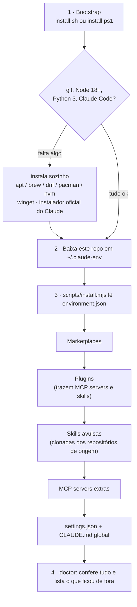

# claude-env

[](https://github.com/izrafilcst/claude-env/actions/workflows/install.yml)

Meu ambiente completo do **Claude Code** (marketplaces, plugins, skills, MCP servers e configurações) reproduzível em qualquer máquina com **um comando**.

| Sistema | Comando |
|---|---|
| **Linux / macOS / WSL** | `curl -fsSL https://raw.githubusercontent.com/izrafilcst/claude-env/main/install.sh \| bash` |
| **Windows (PowerShell)** | `irm https://raw.githubusercontent.com/izrafilcst/claude-env/main/install.ps1 \| iex` |

Pode rodar de novo quantas vezes quiser: o que já está instalado é pulado. **Para atualizar, é o mesmo comando.**

---

## Sumário

- [Como funciona (o guia recursivo)](#como-funciona-o-guia-recursivo)
- [O que é instalado](#o-que-é-instalado)
- [Pós-instalação (uma vez só)](#pós-instalação-uma-vez-só)
- [Catálogo: por que cada extensão + exemplos de prompt](#catálogo-por-que-cada-extensão--exemplos-de-prompt)
- [Referência de comandos](#referência-de-comandos)
- [Como adicionar algo novo ao ambiente](#como-adicionar-algo-novo-ao-ambiente)
- [Solução de problemas](#solução-de-problemas)
- [Créditos](#créditos)

---

## Como funciona (o guia recursivo)

Cada camada instala o que a próxima precisa para existir. Você só dispara a primeira.



| Camada | Arquivo | O que faz |
|---|---|---|
| 1. Bootstrap | [`install.sh`](install.sh) · [`install.ps1`](install.ps1) | Garante as ferramentas de base e baixa o repositório. Única parte que muda entre sistemas. |
| 2. Manifesto | [`environment.json`](environment.json) | **Fonte única da verdade.** Tudo que compõe o ambiente está listado aqui. |
| 3. Instalador | [`scripts/install.mjs`](scripts/install.mjs) | Um só código em Node para Linux, macOS e Windows. Lê o manifesto e chama `claude plugin …`, `claude mcp …` e `git clone`. É idempotente. |
| 4. Verificação | `install.mjs doctor` | Compara o manifesto com a máquina, nos dois sentidos. |

Por segurança, o instalador **nunca apaga nada**. Antes de mexer no `settings.json` ele cria um `settings.json.bak-AAAAMMDDhhmmss`, e no `CLAUDE.md` global ele só acrescenta o bloco que falta.

---

## O que é instalado

| Tipo | Itens | Escopo |
|---|---|---|
| **Marketplaces** | `claude-plugins-official`, `founder-skill`, `replica-skill`, `ruflo` | usuário |
| **Plugins** | `superpowers`, `claude-md-management`, `context7`, `github`, `playwright`, `frontend-design`, `figma`, `founder-skill`, `replica-skill` | usuário |
| **Skills** | 11 × `hunter-*`, 11 × `li-*`, `llm-council`, `council`, `skill-router` | usuário (`~/.claude/skills`) |
| **MCP servers** | `github`, `playwright`, `context7` e `figma` vêm junto com os plugins; o `ruflo` é por projeto | usuário / projeto |
| **Configurações** | modelo `opus`, esforço `xhigh`, TUI fullscreen, tema escuro, notificações push, bloco do ruflo no `CLAUDE.md` global | usuário |
| **Perfil por projeto** | `ruflo`: plugins `ruflo-mods`, `ruflo-swarm`, `ruflo-console` + MCP `ruflo` | projeto (opt-in) |
| **Vem da conta claude.ai** | plugins *knowledge-work*, skills de documentos, conectores Gmail/Drive/Calendar | automático no `/login` |

---

## Pós-instalação (uma vez só)

Quatro coisas dependem de você, porque envolvem login ou segredos:

**1. Login.** Abra `claude` e rode `/login`. Entrando com a mesma conta claude.ai, os [itens da conta](#vem-com-a-conta-claudeai-automático) chegam sozinhos.

**2. Token do GitHub** (para o MCP do plugin `github`). Sem ele, aparece `Authorization header is badly formatted`.

```bash
# Linux / macOS: lê o token do gh a cada novo terminal, sem gravar o segredo no arquivo
echo 'export GITHUB_PERSONAL_ACCESS_TOKEN="$(gh auth token 2>/dev/null)"' >> ~/.bashrc
```

```powershell
# Windows: grava na variável de ambiente do usuário
[Environment]::SetEnvironmentVariable('GITHUB_PERSONAL_ACCESS_TOKEN', (gh auth token), 'User')
```

Sem o `gh`, gere um token em <https://github.com/settings/tokens> e use-o no lugar de `$(gh auth token)`.

**3. Figma.** Dentro do Claude: `/mcp` › `figma` › *Authenticate*.

**4. Ruflo num projeto** (opcional). Veja [ruflo](#ruflo--orquestração-multiagente-por-projeto).

Para conferir tudo: `~/.claude-env/install.sh doctor` (Windows: `& "$HOME\.claude-env\install.ps1" -Command doctor`).

---

## Catálogo: por que cada extensão + exemplos de prompt

> Nos exemplos, `/nome` chama a skill direto. Na maioria dos casos, descrever o pedido em português já basta, porque o Claude escolhe a skill sozinho pela descrição.

### Plugins oficiais (`anthropics/claude-plugins-official`)

#### superpowers: disciplina de engenharia
**Por quê:** impede o Claude de sair codando. Impõe um fluxo de engenheiro sênior: *brainstorm → plano → TDD → revisão → verificação antes de dizer "pronto"*. É o plugin que mais muda a qualidade do resultado em tarefas grandes.
Skills principais: `brainstorming`, `writing-plans`, `executing-plans`, `subagent-driven-development`, `test-driven-development`, `systematic-debugging`, `verification-before-completion`, `requesting-code-review`, `using-git-worktrees`.

```text
Quero adicionar login por magic link na API. Vamos fazer um brainstorm antes de escrever código.
Escreva um plano de implementação para migrar o banco de SQLite para Postgres.
Os testes de integração quebraram depois do último merge. Investigue a causa raiz antes de propor correção.
Execute o plano em docs/plans/auth.md usando subagentes, uma tarefa por vez, com revisão entre elas.
```

#### claude-md-management: memória de projeto em dia
**Por quê:** o `CLAUDE.md` é o que o Claude lê no início de toda sessão. Este plugin audita esses arquivos e grava neles o que foi aprendido na sessão, para você não repetir contexto.

```text
/revise-claude-md
Audite os CLAUDE.md deste repositório e diga o que está desatualizado ou faltando.
```

#### context7: documentação atualizada de bibliotecas
**Por quê:** o conhecimento do modelo tem data de corte. O Context7 busca a documentação **da versão atual** da lib, o que evita APIs inventadas ou obsoletas. Usa servidor remoto, sem instalar nada localmente.

```text
Use o context7 para ver como configurar middleware no Next.js atual e aplique neste projeto.
Consulte a doc do FastAPI via context7: qual o jeito certo de usar lifespan hoje?
```

#### github: GitHub de dentro do Claude
**Por quê:** é o MCP oficial do GitHub para issues, PRs, revisões, busca de código e Actions sem sair do terminal. *Precisa do token (pós-instalação, passo 2).*

```text
Liste as issues abertas com label "bug" no repositório X e agrupe por área.
Abra um PR desta branch com descrição gerada a partir dos commits.
Revise o PR #42 e comente linha a linha o que estiver errado.
Por que o último workflow do Actions falhou? Leia o log e proponha a correção.
```

#### playwright: navegador automatizado
**Por quê:** permite ao Claude abrir páginas, clicar, preencher formulários, tirar screenshots e ler o console. Serve para testar a UI que ele acabou de escrever, fazer scraping e automatizar tarefas web.

```text
Abra http://localhost:3000, faça login com o usuário de teste e tire um screenshot do dashboard.
Navegue até <url>, extraia a tabela de preços e salve como CSV.
Teste o fluxo de cadastro no celular (viewport 390x844) e liste os bugs visuais.
```

#### frontend-design: interfaces com identidade
**Por quê:** sem orientação, interfaces geradas por IA saem todas parecidas (gradiente roxo, cards genéricos). Esta skill força decisões de design reais: tipografia, hierarquia, paleta e movimento.

```text
Crie uma landing page para meu portfólio de segurança ofensiva, estética de terminal retrô, em HTML + Tailwind.
Redesenhe este dashboard com uma identidade visual mais ousada, mantendo a acessibilidade.
```

#### figma: ponte design ↔ código
**Por quê:** lê frames do Figma e transforma em código no padrão do seu projeto. Também faz o caminho inverso, gerando telas, design systems e diagramas FigJam a partir do código.

```text
Implemente este frame em React usando os componentes que já existem no projeto: <link do Figma>
Gere no Figma a tela de login baseada em src/pages/Login.tsx.
Crie um diagrama de arquitetura deste repositório no FigJam.
```

### founder-skill: validar um negócio antes de gastar dinheiro
**Por quê:** reúne 11 "funcionários" de uma startup que levam uma ideia até um plano de negócio com números rastreáveis. Os painéis de consumidores são simulados com subagentes, e o lançamento sempre começa com um teste barato no mundo real.

| Skill | Papel |
|---|---|
| `founder-board` | Conselho de 3 lentes (ofertas, monopólio, …) dá o veredito sobre a ideia |
| `founder-consumer` | Painel de 20 a 100 compradores simulados reage ao seu pitch |
| `founder-competitors` | Mapeia concorrentes diretos e indiretos e acha o espaço livre |
| `founder-pricing` | Faixa de preço por Van Westendorp |
| `founder-offer` | Monta uma oferta irrecusável com bônus honestos |
| `founder-cfo` | Margem, ponto de equilíbrio, caixa necessário, ano 1 mês a mês |
| `founder-marketing` | Posicionamento, canais, campanha de 30 dias |
| `founder-brand` | Nome (com checagem de marca e domínio), voz, tagline, briefing visual |
| `founder-ops` | Fornecedores, rotinas, ferramentas e licenças do dia 1 |
| `founder-launch` | Plano de lançamento com data, começando por um teste real |
| `founder-plan` | Compila tudo num plano de negócio |

```text
/founder-board Quero abrir uma consultoria de pentest para pequenas empresas.
/founder-consumer Teste este pitch com 100 donos de PME: "Pentest mensal por assinatura a partir de R$ 900".
/founder-cfo Ticket de R$ 3.000, 4 clientes por mês, custo fixo de R$ 2.000. Fecha a conta?
/founder-plan Junte tudo o que já foi feito num plano de negócio.
```

### replica-skill: estudar um app e construir a sua versão
**Por quê:** é um pipeline para entender como um produto funciona e construir algo melhor. Começa no reconhecimento (telas, fluxos, modelo de dados), passa por arquitetura, design, build e testes, e termina no que os usuários reclamam e em como se posicionar.

| Etapa | Skills |
|---|---|
| Entender | `replica-recon` (telas, fluxos, dados), `replica-entrepreneur` (reclamações reais dos usuários e posicionamento) |
| Planejar | `replica-architect` (stack, schema SQL, API), `replica-design`, `replica-brand` |
| Construir | `replica-build`, `replica-backend`, `replica-test` |
| Comparar e lançar | `replica-diff`, `replica-deploy`, `replica-launch` |

```text
/replica-recon Quero construir minha própria ferramenta de agendamento. Mapeie as telas e os fluxos do Calendly.
/replica-architect Planeje stack, schema e rotas a partir do recon.
/replica-entrepreneur O que os usuários mais odeiam nesse tipo de app? Como eu me diferencio?
```

### ruflo: orquestração multiagente (por projeto)
**Por quê:** adiciona *swarms* de agentes coordenados, memória vetorial persistente entre sessões e roteamento inteligente de tarefas. Fica **por projeto** porque instala hooks e sobe um MCP via `npx`: pesado demais para toda sessão, ótimo em projetos grandes. O bloco no `CLAUDE.md` global avisa o Claude para procurar as ferramentas do ruflo quando elas existem.

Ligar num projeto:

```bash
cd ~/dev/meu-projeto && ~/.claude-env/install.sh project ruflo
```

```powershell
& "$HOME\.claude-env\install.ps1" -Command project -Name ruflo -Dir C:\dev\meu-projeto
```

| Plugin | Função |
|---|---|
| `ruflo-mods` | ruflo como *mod* do Claude Code: roteamento por hooks, dentro do processo |
| `ruflo-swarm` | Times de agentes, coordenação de swarm, isolamento por worktree |
| `ruflo-console` | Cockpit do ruflo e o comando `/ruflo` |
| MCP `ruflo` | Ferramentas `memory_store`, `memory_search`, `swarm_init`, `agent_spawn`, `hooks_route` |

```text
/ruflo
Inicie um swarm com 3 agentes para refatorar o módulo de pagamentos em paralelo, cada um numa worktree.
Guarde na memória do ruflo as decisões de arquitetura desta sessão.
Busque na memória do ruflo o que decidimos sobre a estratégia de cache.
```

### hunter-skill: busca de emprego de ponta a ponta
**Por quê:** cobre o funil inteiro de uma vaga, da busca à negociação, com todos os dados num único `hunter/pipeline.json`. Tem regras rígidas: **só usa o que é verdade sobre você** (o currículo passa por um *truth check*) e **nada é enviado sem o seu "sim"**.

| Skill | Faz |
|---|---|
| `hunter-scout` | Busca vagas abertas em boards públicos e ranqueia por aderência ao seu perfil |
| `hunter-resume` | Reescreve o currículo para cada vaga, com nota ATS de 0 a 100 e verificação de veracidade |
| `hunter-research` | Brief de uma página sobre a empresa (documentos públicos, notícias, time) |
| `hunter-linkedin` | Ajusta headline, About e skills para a vaga-alvo, dentro dos limites do LinkedIn |
| `hunter-connector` | Acha o gestor da vaga, rascunha e-mail e nota do LinkedIn, faz follow-up até o café |
| `hunter-cover` | Carta de apresentação específica, com prova numérica e checagem de clichês |
| `hunter-apply` | Preenche a candidatura no navegador e **para antes do Submit** |
| `hunter-interview` | Entrevista simulada com perguntas reais da empresa e correção no formato STAR |
| `hunter-salary` | Calcula a remuneração total e roteiriza a contraproposta |
| `hunter-followup` | Lista diária de quem cobrar, com regras para não virar spam |
| `hunter-tracker` | O pipeline: estágios, contatos e próximos passos |

```text
/hunter-scout Vagas júnior de AppSec e Red Team, remotas.
/hunter-resume Adapte meu currículo para esta vaga: <url>
/hunter-research Faça o brief da empresa antes da minha entrevista de quinta.
/hunter-interview Simule a rodada comportamental da Amazon (Leadership Principles).
/hunter-salary Recebi R$ 8.000 + benefícios. Monte a contraproposta.
/hunter-followup Quem eu preciso cobrar hoje?
```

### linkedin-agent-skill: presença no LinkedIn sem cara de IA
**Por quê:** para construir autoridade técnica com constância. São 21 fórmulas de gancho, um plano semanal e respostas a comentários. O diferencial é o `li-human`, que tira as marcas de texto gerado por IA (travessões, palavras-clichê, caracteres invisíveis) e dá nota antes de publicar. **Nada é publicado sem confirmação.**

| Skill | Faz |
|---|---|
| `li-post` | Post a partir de uma ideia crua: 3 opções de gancho + rascunho final |
| `li-carousel` | Carrossel (post em PDF) slide a slide |
| `li-plan` | Semana de conteúdo: o que postar, quando e com quem interagir |
| `li-repurpose` | Transforma vídeo, podcast, artigo ou transcrição numa semana de posts |
| `li-comment` | Comentários com opinião nos posts dos outros |
| `li-reply` | Respostas aos comentários dos seus posts, priorizadas |
| `li-dm` | Convite de conexão (200 caracteres) e sequência de DMs |
| `li-inbox` | Triagem da caixa de entrada: leads, recrutadores, colegas, spam |
| `li-profile` | Nota do perfil de 0 a 100 e reescrita das partes fracas |
| `li-audit` | Pós-morte dos posts publicados: o que funcionou e por quê |
| `li-human` | Remove as marcas de IA de qualquer texto e dá nota |

```text
/li-post Hoje explorei um SSRF num laboratório e aprendi X. Transforme em post.
/li-profile Avalie meu perfil (colado abaixo) e reescreva o headline.
/li-plan Planeje minha semana de conteúdo sobre AppSec para iniciantes.
/li-repurpose Transforme esta transcrição de palestra em 5 posts.
/li-human Tire a cara de IA deste texto: ...
```

### llm-council e council: decisões difíceis vistas de vários ângulos
**Por quê:** uma única resposta não mostra se ela é boa. Os dois "conselhos" fazem a mesma pergunta a cinco conselheiros independentes, cada um com um viés diferente.

| | `llm-council` | `council` |
|---|---|---|
| Origem | [tenfoldmarc/llm-council-skill](https://github.com/tenfoldmarc/llm-council-skill) (método do Karpathy) | Skill local deste repositório |
| Como roda | 5 subagentes → revisão anônima entre eles → um "presidente" sintetiza o veredito | 5 chamadas `claude -p` isoladas (Contrarian, First-principles, Outsider, Executor, Expansionist) |
| Saída | Relatório HTML + transcrição, com recomendação final | As 5 respostas lado a lado, **sem síntese** |
| Quando usar | Decisão com muito em jogo, quando você quer um veredito | Uma segunda opinião rápida, deixando você julgar |

```text
council this: aceito a proposta CLT ou continuo como freelancer?
/llm-council Analise @software.docx tecnicamente (está completo?) e academicamente (falhas de comunicação).
/council Vale a pena migrar meu blog de WordPress para Astro?
```

### skill-router: qual skill usar agora?
**Por quê:** com mais de 200 skills instaladas, é impossível lembrar de todas. O router indexa o que está em `~/.claude/skills` uma vez por sessão e sugere (ou aplica sozinho) a skill certa para cada pedido.

```text
/skill-router on          # sugere as skills mais relevantes e espera você confirmar
/skill-router on --auto   # roteia sozinho e assina a resposta com *(via nome-da-skill)*
/skill-router status
```

### Vem com a conta claude.ai (automático)
Estes itens **não** são instalados pelo script: eles sincronizam sozinhos quando você faz `/login` com a mesma conta. Instalar por cima duplicaria as skills.

**Plugins *knowledge-work* (Anthropic).** Cada um traz skills de uma área de trabalho:

| Plugin | Para quê | Exemplo de prompt |
|---|---|---|
| `engineering` | ADRs, system design, code review, incidentes, deploy checklist | `/engineering:architecture Kafka ou SQS para a fila de eventos?` |
| `data` | Análise, SQL, visualizações, validação | `/data:analyze Qual a correlação entre X e Y neste CSV?` |
| `design` | Crítica de design, acessibilidade, UX writing, handoff | `/design:accessibility-review Revise esta tela` |
| `product-management` | Specs, roadmap, pesquisa, métricas | `/product-management:write-spec Exportação em PDF` |
| `legal` | Revisão de contrato, NDA, compliance | `/legal:review-contract Revise este contrato de prestação de serviço` |
| `pdf-viewer` | Abrir, anotar, preencher e assinar PDFs | `Abra este contrato e destaque as cláusulas de multa` |
| `marketing`, `sales`, `customer-support`, `brand-voice` | Conteúdo, campanhas, CRM, atendimento, voz da marca | `/marketing:seo-audit meu-site.com` |
| `operations`, `human-resources`, `finance` | Processos, runbooks, RH, contabilidade | `/operations:runbook Deploy manual do servidor` |
| `productivity`, `enterprise-search` | Tarefas, memória, busca em várias fontes | `/productivity:start` |
| `apollo`, `slack-by-salesforce`, `cowork-plugin-management` | Prospecção, Slack, criar plugins próprios | `/cowork-plugin-management:create-cowork-plugin` |

**Skills da conta:** `docx`, `xlsx`, `pptx`, `pdf` (gerar e editar arquivos Office/PDF), `deep-research` (pesquisa com várias fontes e relatório), `skill-creator` (criar novas skills), `docs`, `morning`, `import-memory`, `chrome-browser`, `built-in-browser`, `computer-use`, além das suas próprias uploads (`curriculo-ats`, `infoproduct-author`). As uploads ficam **só na conta**, de propósito, porque podem ter dados pessoais.

**Conectores:** Gmail, Google Calendar, Google Drive, Claude Docs e Artifacts.

```text
Pesquise o mercado de AppSec no Brasil em 2026 e me entregue um relatório com fontes.
Gere uma planilha .xlsx com meu controle de candidaturas, com fórmulas de taxa de resposta.
Crie uma apresentação .pptx de 10 slides a partir deste relatório.
```

> **Máquina sem essa conta?** Use `--with-cowork` (Windows: `-WithCowork`) para instalar os equivalentes públicos do GitHub ([knowledge-work-plugins](https://github.com/anthropics/knowledge-work-plugins) + `document-skills` de [anthropics/skills](https://github.com/anthropics/skills)).

### Configurações aplicadas

| Chave | Valor | Por quê |
|---|---|---|
| `model` | `opus` | Modelo mais capaz por padrão |
| `effortLevel` / `modelSettings` | `xhigh` | Mais raciocínio por resposta no Opus e no Sonnet |
| `tui` | `fullscreen` | Interface em tela cheia |
| `theme` | `dark` | Tema escuro |
| `agentPushNotifEnabled` | `true` | Avisa quando um agente em segundo plano termina |
| `CLAUDE.md` global | bloco do ruflo | Lembra o Claude de usar as ferramentas do ruflo quando o projeto tiver |

---

## Referência de comandos

| O que | Linux / macOS / WSL | Windows (PowerShell) |
|---|---|---|
| Instalar ou atualizar | `curl -fsSL …/install.sh \| bash` | `irm …/install.ps1 \| iex` |
| Simular sem alterar nada | `curl -fsSL …/install.sh \| bash -s -- --dry-run` | `& ([scriptblock]::Create((irm …/install.ps1))) -DryRun` |
| Conferir o ambiente | `~/.claude-env/install.sh doctor` | `& "$HOME\.claude-env\install.ps1" -Command doctor` |
| Rodar só algumas etapas | `~/.claude-env/install.sh --only skills,settings` | `… install.ps1 -Only skills,settings` |
| Ligar o ruflo num projeto | `~/.claude-env/install.sh project ruflo <pasta>` | `… install.ps1 -Command project -Name ruflo -Dir <pasta>` |
| Incluir plugins da conta | `… --with-cowork` | `… -WithCowork` |
| Testar sem tocar no seu `~/.claude` | `CLAUDE_CONFIG_DIR=/tmp/teste ./install.sh` | `$env:CLAUDE_CONFIG_DIR='C:\tmp\teste'; .\install.ps1` |

`…` = `https://raw.githubusercontent.com/izrafilcst/claude-env/main`. Etapas válidas para `--only`: `marketplaces`, `plugins`, `skills`, `mcp`, `settings`.

Variáveis opcionais: `CLAUDE_ENV_HOME` (onde clonar; padrão `~/.claude-env`) e `CLAUDE_ENV_REPO` (usar um fork).

---

## Como adicionar algo novo ao ambiente

1. Instale normalmente pelo Claude (`/plugin install …`, uma skill nova, etc.).
2. Rode `doctor`. A seção **"Instalado aqui, mas fora do manifesto"** lista o que é novo.
3. Acrescente ao [`environment.json`](environment.json):

```jsonc
{
  "marketplaces": [{ "name": "meu-mkt", "source": "dono/repo" }],
  "plugins": ["plugin@meu-mkt"],
  "skills": [
    // pacote de skills de um repositório (copia as pastas listadas em "include")
    { "name": "pacote", "repo": "https://github.com/dono/repo", "path": "skills", "include": ["skill-a", "skill-b"] },
    // repositório que é uma skill só, com o SKILL.md na raiz
    { "name": "uma-skill", "repo": "https://github.com/dono/repo", "path": ".", "as": "uma-skill" }
  ],
  "mcpServers": [
    { "name": "remoto", "url": "https://exemplo.com/mcp" },
    { "name": "local", "command": "npx", "args": ["-y", "pacote-mcp"] }
  ]
}
```

   Skills sem repositório público vão para a pasta [`skills/`](skills) e entram no pacote `local`. Segredos **nunca** vão no manifesto: use variáveis de ambiente.

4. `git commit` + `git push`. O [CI](.github/workflows/install.yml) instala tudo do zero em Ubuntu, macOS e Windows e roda o `doctor`. Ele também roda toda segunda-feira, para pegar quebras nos repositórios de terceiros.

---

## Estrutura do repositório

```text
claude-env/
├── install.sh              # bootstrap Linux/macOS/WSL
├── install.ps1             # bootstrap Windows
├── environment.json        # o manifesto: tudo que compõe o ambiente
├── scripts/install.mjs     # instalador único (install | doctor | project)
├── skills/                 # skills sem repositório público (council, skill-router)
├── config/CLAUDE.md        # bloco do CLAUDE.md global
└── .github/workflows/      # CI nos 3 sistemas
```

---

## Solução de problemas

| Sintoma | Causa e solução |
|---|---|
| MCP `github`: *Authorization header is badly formatted* | `GITHUB_PERSONAL_ACCESS_TOKEN` não definido. Veja a [pós-instalação](#pós-instalação-uma-vez-só), passo 2. |
| Windows: *a execução de scripts foi desabilitada* | Rode o arquivo local com `powershell -ExecutionPolicy Bypass -File install.ps1`. O `irm \| iex` não é afetado. |
| `claude` não encontrado logo depois de instalar | O PATH só vale em terminais novos. Abra outro e rode o comando de novo. |
| Demora na etapa de marketplaces | O repositório do `ruflo` é grande. A primeira instalação pode levar alguns minutos; as seguintes são rápidas. |
| Skills `hunter-*` reclamam de `python3` no Windows | O instalador do Python para Windows cria `python`/`py`, mas não `python3`. Peça ao Claude para usar `python`, ou desative o alias `python3` da Microsoft Store em *Configurações › Aplicativos › Aliases de execução*. |
| Quero desfazer as configurações | Restaure o `~/.claude/settings.json.bak-*` mais recente. Plugins saem com `claude plugin uninstall <id>` e skills apagando a pasta em `~/.claude/skills/`. |

---

## Créditos

| Projeto | Autor | Licença |
|---|---|---|
| [claude-plugins-official](https://github.com/anthropics/claude-plugins-official) | Anthropic e parceiros | várias |
| [superpowers](https://github.com/obra/superpowers) | Jesse Vincent | MIT |
| [founder-skill](https://github.com/Jakeschincariol/founder-skill) · [replica-skill](https://github.com/Jakeschincariol/replica-skill) · [hunter-skill](https://github.com/Jakeschincariol/hunter-skill) · [linkedin-agent-skill](https://github.com/Jakeschincariol/linkedin-agent-skill) | Jake Schincariol | MIT |
| [llm-council-skill](https://github.com/tenfoldmarc/llm-council-skill) | tenfoldmarc | não informada |
| [ruflo](https://github.com/ruvnet/ruflo) | rUv | MIT |
| [knowledge-work-plugins](https://github.com/anthropics/knowledge-work-plugins) | Anthropic | Apache-2.0 |

Este repositório só **aponta** para os projetos acima e os instala a partir das fontes originais. As exceções são `council` e `skill-router` (este sob MIT), que não têm repositório público conhecido e por isso estão copiadas em [`skills/`](skills).

Licença deste repositório: [MIT](LICENSE).
